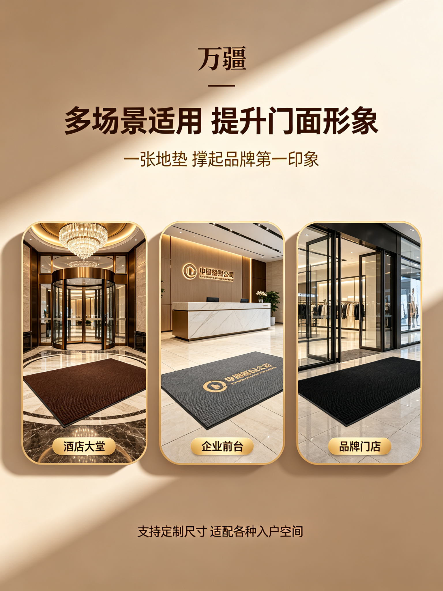
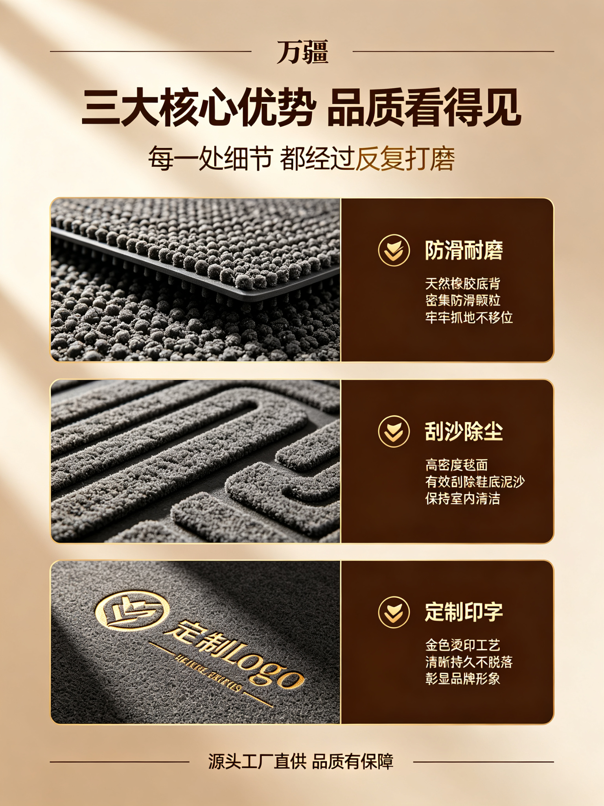
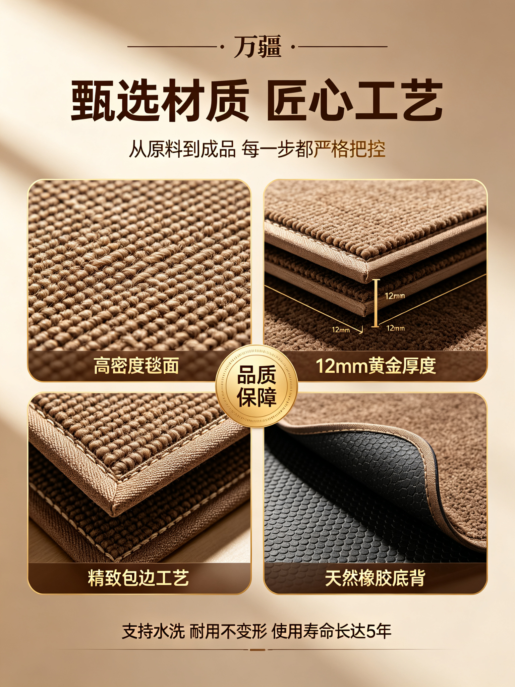
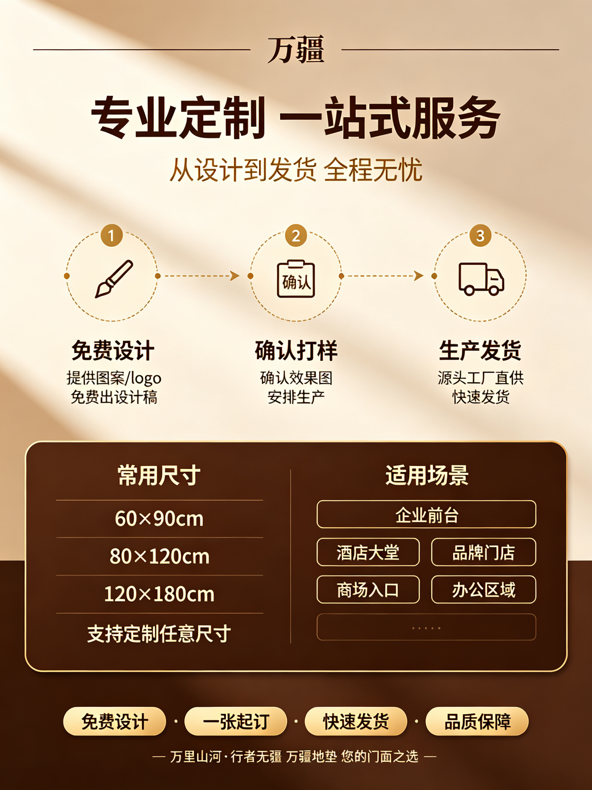

# 淘宝电商图片大师 Skill（Taobao Ecommerce Image Master）

> 一站式电商商品描述图生产技能：商品解析 → 分屏规划 → 逐屏生成 → 垂直拼接 → 交付。
> 支持在 **腾讯 WorkBuddy**、**豆包办公**、**CodeX**、**Claude** 等 AI 工作台 / Agent 环境中加载运行。


**完整拼合长图（5 屏拼接，1536 × 10240）**：首屏主视觉 → 场景展示 → 核心卖点 → 材质工艺 → 定制规格，视觉风格统一、过渡流畅、无视觉偏差。

---

## 组图（各屏独立竖图，1536 × 2048）

### 屏 1：首屏主视觉
品牌标识 + 产品全貌 + 三项核心服务承诺（防滑耐磨 / 免费设计 / 源头工厂）


### 屏 2：场景展示
酒店大堂、企业前台、品牌门店三大商用场景卡片



### 屏 3：核心卖点拆解
防滑耐磨、刮沙除尘、定制印字三大卖点，左右分栏 + 微距特写



### 屏 4：材质工艺细节
高密度毯面、12mm 黄金厚度、精致包边、天然橡胶底背四宫格 Bento 布局



### 屏 5：定制服务与规格
三步定制流程（免费设计 → 确认打样 → 生产发货）+ 常用尺寸 + 适用场景



---

## 安装与使用

### 1. 安装 Skill

将本仓库克隆或下载到目标 AI 工作台的技能根目录（各平台路径示例）：

| 平台 | 技能根目录（示例） |
|---|---|
| 腾讯 WorkBuddy | `<工作区>/.skills/` 或平台指定的 Skill 目录 |
| 豆包办公 | `<工作区>/.skills/`（置于 skill root 下即可被发现） |
| CodeX | 按 CodeX 技能安装机制放入对应目录 |
| Claude | `~/.claude/skills/` 或项目 `.claude/skills/` |

```bash
git clone https://github.com/<your-username>/taobao-ecommerce-image-master.git
# 然后将仓库内的 SKILL.md 与 assets/ 放入目标平台的技能目录
```

### 2. 触发示例

在任意支持的环境中对 Agent 说：

> "搜索淘宝某店铺销量最高的商品，解析后制作拼合的竖图商品描述，要求多图、过渡流畅、视觉无偏差。"

Agent 将按本 Skill 的流程执行：

1. **商品解析**：检索并采集目标商品的信息与卖点（平台受阻时切换可回溯来源，不编造数据）
2. **分屏规划**：首屏定调 → 场景 → 卖点 → 材质 → 规格，一屏只做一件事
3. **逐屏生成**：锁定全局视觉锚点（配色 / 字体层级 / 光影方向 / 品牌衔接），逐屏独立生成
4. **垂直拼接**：统一宽度、等比缩放、逐张拼接为长图
5. **验证交付**：回读长图与各屏、核对文字与画幅，交付长图 + 组图

---

## 核心方法

### 视觉一致性锚点（保证"过渡流畅、视觉无偏差"）

| 锚点 | 规范示例 |
|---|---|
| 配色 | 深棕 + 金 + 米色渐变，全屏统一 |
| 字体层级 | 衬线品牌字 / 粗体无衬线主标题 / 金色副标题 |
| 光影 | 统一左上主光源，产品带自然立体感 |
| 品牌衔接 | 每屏顶部保留品牌标识 |
| 画幅 | 每屏固定 3:4（如 1536×2048） |

### 拼合脚本（Python PIL）

```python
from PIL import Image

images = [Image.open(f'img{i}.jpg') for i in range(1, 6)]
min_width = min(img.width for img in images)
resized = [img.resize((min_width, int(img.height * min_width / img.width)), Image.LANCZOS) for img in images]
total_height = sum(img.height for img in resized)
combined = Image.new('RGB', (min_width, total_height))
y = 0
for img in resized:
    combined.paste(img, (0, y)); y += img.height
combined.save('detail_long.jpg', quality=95)
```

---

## 合规说明

- 不编造销量、价格、评分、认证、功效数据；缺失时标注"待补充"并说明口径
- 不使用极限词、虚假承诺、贬低竞品表述
- 平台登录/验证码受阻时如实告知，不凭经验补全商品信息

## 目录结构

```
taobao-ecommerce-image-master/
├── SKILL.md            # Skill 定义与完整工作流
├── README.md           # 本文件
└── assets/             # 示例产物
    ├── wanjiang_carpet_detail.jpg  # 拼接长图（示例）
    ├── img1.jpg                    # 屏1 首屏主视觉
    ├── img2.jpg                    # 屏2 场景展示
    ├── img3.jpg                    # 屏3 核心卖点
    ├── img4.jpg                    # 屏4 材质工艺
    └── img5.jpg                    # 屏5 定制规格
```

## License

MIT
